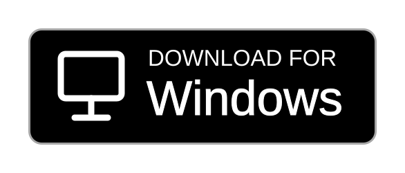

## 下載 Download

 

> [!CAUTION]
> Google Play 版需要經過商店審核，通常會比這裡晚幾小時到幾天才更新到這個版本；商店還沒出現新版本時請稍後再查看。
>
> The Google Play version must pass store review, so it usually updates to this version a few hours to a few days later than this page. If the store doesn't show the new version yet, please check back later.

Google Play 和 Google Play 標誌是 Google LLC 的商標。Google Play and the Google Play logo are trademarks of Google LLC.

## 貢獻翻譯 Contribute Translation

請協助我們將軟體翻譯成各國語言！

Please help us translate this software!

<https://crowdin.com/project/wuthering-waves-convene-gacha-analyzer>

## 支援其他遊戲的版本 Versions for Other Games

- 原神 Genshin Impact：<https://github.com/GoneTone/genshin-impact-wish-gacha-analyzer>
- 未來可能新增支援更多遊戲... More games may be supported in the future...

## 注意 Notice

**_Windows 版在安裝或執行時有可能會被防毒軟體阻擋，如果無法正常執行，請嘗試關閉防毒軟體後再執行看看，本軟體保證無毒。_**

**_The Windows version may be blocked by antivirus programs during installation or execution. If it cannot run normally, please try disabling your antivirus software before running it again. This software is guaranteed to be virus-free._**
